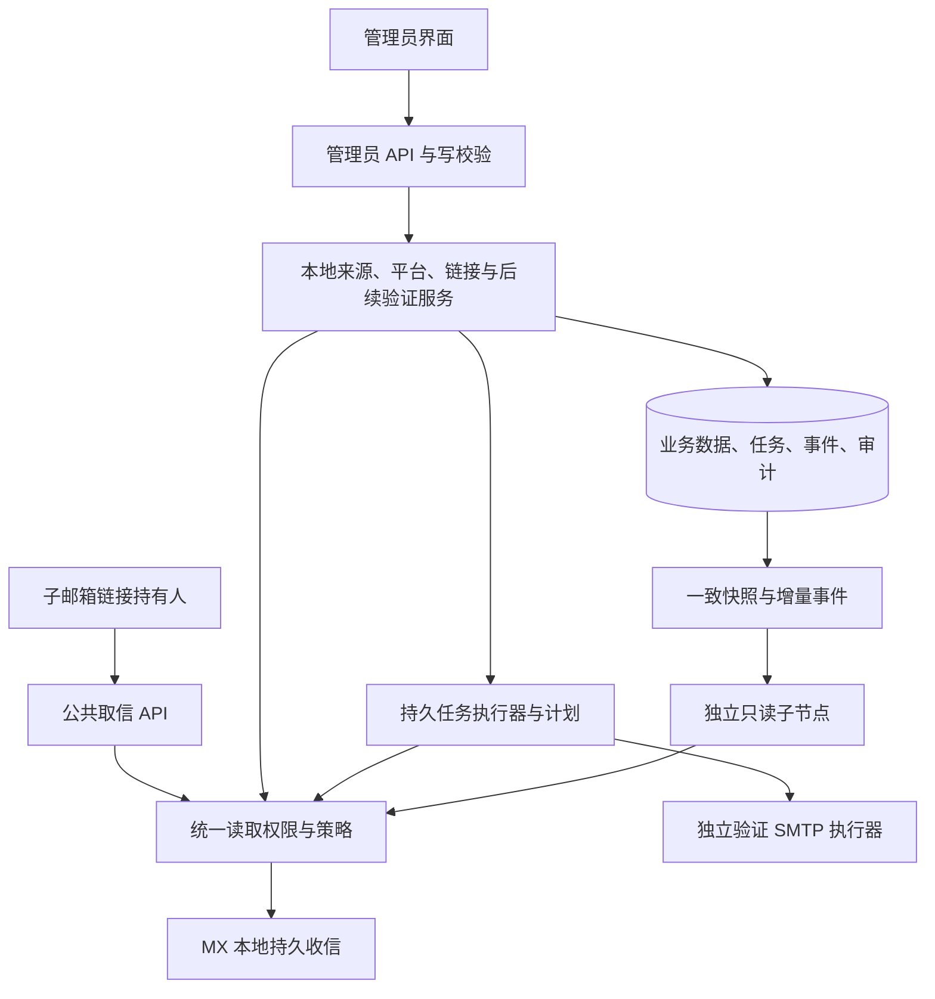

# 本地收信与子邮箱链接技术方案

2026-11-16 增补：用户已确认并授权开发本地邮箱兑换码、一次性核销、重新生成、TXT/ZIP 交付和订单查询，规则见 [邮箱卡密方案](mailbox-cards-plan.md)。本次增补覆盖本文旧版对卡密范围的排除，历史外部来源卡密不自动迁入。

状态：方案基线；已开始实施，当前进度见[首批实现说明](recipient-links-implementation.md)  
日期：2026-11-13  
目标项目：Cloud Mail 当前工作区（包含现有尚未提交的自托管改造）  
历史需求参考：[feature-migration-requirements.md](feature-migration-requirements.md) v1.0（原始副本保留）  
开发拆分：[feature-migration-development-breakdown.md](feature-migration-development-breakdown.md)

## 1. 本轮结论与范围

用户最新明确：**不需要对接 Outlook、iCloud，只使用 MX/本地收信，为同一主邮箱下的多个子邮箱生成独立收件链接。此范围优先于历史需求参考，原始需求副本不作改写。**

保留 Node.js 24、Hono、Vue 3、Element Plus、Drizzle、SQLite 和 Postfix。当前核心交付为本地主邮箱目录、严格按 SMTP 信封收件人隔离的子邮箱链接、管理页与公开页面/JSON。链接相关 L 和安全/一致性 R 要求继续适用；验证、计划、节点的后续设计仅面向本地来源，不包含外部邮箱协议、OAuth、Graph、IMAP 或真实外部邮箱联调。

历史外部来源卡密基线不直接用于 MX。用户已另行确认本地规则：一码绑定一个主邮箱、每码一次性核销、可停用/换新码、默认长期；交付全部子邮箱的 TXT，批量按主邮箱分文件 ZIP 打包，并提供订单查询。卡密管理、公开兑换及 R-11 请求体精确搜索现纳入本轮实现，以新方案为准。

暂按以下口径安排开发，可在评审中调整：

- 本地链接功能先行；生产旧数据迁移单独估算，在确定“空数据上线/承接旧业务”前不执行数据导入。承接业务时仅迁移已确认在范围内的本地来源、URL、期限、策略与历史；外部账号及卡密不自动纳入。
- 管理端沿用现有登录身份，仅站点管理员可使用新模块；不扩大为新增运营角色系统。
- 基础发布采用一个可写主节点、多个独立公共读取子节点；**多个主节点实例不是当前架构已具备的能力**，其要求与排期见第 10 节。
- 支付、销售库存、退款、跨节点统计和主节点自动故障切换不纳入本次默认范围；本地兑换订单、一次性核销和重新生成按 2026-11-16 新确认范围交付。

## 2. 当前项目差距

以下结论来自静态代码审查，不代表已运行新模块或真实邮箱测试。

| 方面 | 当前实现与核对位置 | 方案处理 |
| --- | --- | --- |
| 邮箱目录 | `mail-worker/src/entity/account.js:3` 是归属登录用户的本地域名邮箱；`service/account-service.js:38` 限制站点域名 | 来源主邮箱关联现有本地账号或显式受控域名，不创建外部来源 |
| 邮件读取 | 本地 SQLite 已有邮件及 SMTP 信封收件地址 | 复用本地持久收信；外部邮箱适配不在当前范围 |
| MX 收件隔离 | `server/inbound.js:101` 保留完整信封地址；`server/policy.js:53` 可将 plus 地址归入同一账号 | 公共读取精确匹配信封完整地址，不能只按 accountId 查询 |
| 既有公共 API | `service/public-service.js:21` 是持全站开放 API Token 的邮件检索 | 不作为匿名链接接口直接开放；新接口只能读取链接授权范围 |
| 卡密 | 历史规则仅面向外部来源；注册邀请密钥功能已移除 | 新增本地一次性兑换码、重新生成、订单与 TXT/ZIP 交付，不迁移外部历史卡密 |
| 认证授权 | `security/security.js:112` 使用 Authorization JWT 和服务端 Token 列表；旧路径权限白名单不能覆盖新路由 | 新管理路由显式管理员校验；写请求增加来源/CSRF 校验，不假设当前已有 Cookie 会话 |
| API 边界 | `hono/hono.js:7` 全局 CORS；业务错误主要封装为 JSON，未统一真实 HTTP 状态 | 新模块独立 Router、错误处理和 CORS；公开接口返回真实状态码 |
| 后台任务 | `server/mail-schema.js:8` 有投递 outbox；没有导入/验证任务与检测项模型 | 新建持久任务系统；验证复检不进入普通 outbox 的重试逻辑 |
| 调度 | `server/scheduler.js:8` 为进程内 60 秒维护，按 UTC 划日 | 新增按系统时区运行的 15 秒计划检查器，保持现有维护职责独立 |
| 部署 | `server/lock.js:16` 明确只支持单实例；`server/config.js:26` 禁止 APP_URL 路径 | 保留单主保护；单独实现部署前缀与公开根地址，不能删除文件锁冒充多主 |
| 代理 | `server/config.js:41` 默认信任代理；`server/app.js:13` 未核对代理来源 | 改为显式可信代理 CIDR，与 socket 来源结合计算客户端 IP |
| 正文展示 | `mail-vue/src/components/shadow-html/index.vue:111` 使用 Shadow DOM | 新公开正文使用 sandbox iframe、受限 CSP 和资源清理；Shadow DOM 不能提供所需隔离 |
| 公开路由 | `mail-vue/src/router/index.js:107` 将未登录访问转到登录；`server/app.js:53` 将最后一段含点路径当资源 | 显式挂公开布局与后端页面路由，覆盖 `john.smith`、完整邮箱等路径 |
| 秘密与恢复 | 现有工具只有密码哈希；`docker/backup.sh:11` 复制 `.env` | 增加认证加密与密钥版本管理；补充备份加密/密钥分离和恢复演练 |

## 3. 总体架构与代码边界

建议新增以下边界，保持现有邮箱业务可独立使用：

| 目录/文件 | 职责 |
| --- | --- |
| `mail-worker/src/modules/mail-sources/` | 本地来源目录、账号/域名范围及精确信封读取 |
| `mail-worker/src/modules/public-mail/` | 链接解析、AccessContext、平台匹配、正文、短缓存及分页会话 |
| `mail-worker/src/modules/links/` | 子邮箱链接导入、批量、期限、平台及导出 |
| `mail-worker/src/modules/tasks/`、`verification/` | 任务基础、来源同步、检测、SMTP、每日计划 |
| `mail-worker/src/modules/cluster/` | 节点生命周期、字段投影、快照、事件和读取授权 |
| `mail-worker/src/modules/shared/` | 管理安全、秘密保护、网络策略、URL 构造、导出、审计及容量 |
| `mail-worker/src/server/migrations.js` | 所有新增持久模型的有序版本迁移 |
| `mail-worker/src/server/app.js` | 先挂新模块和公开路由，再进入旧 `/api/*` 分发与静态资源兜底 |
| `mail-vue/src/views/links/`、`verification/`、`nodes/` | 链接管理及后续本地验证、节点页面 |
| `mail-vue/src/views/public-mail/` | 独立公开取信布局，不注入管理员身份 |
| `mail-vue/src/composables/` | 请求防竞态、分页、任务轮询、配置就绪、导出状态 |

新模块管理、公共、内部同步三类 Router 分别实施身份与角色边界，不能使用一个宽泛匿名白名单。子节点按角色装配：只挂公共读取、必要内部客户端与健康检查；不挂旧用户/管理/开放 API，也不启动 LMTP、普通发件循环、验证或计划。

## 4. 数据与一致性设计

### 4.1 建议模型

| 模型 | 关键内容和约束 |
| --- | --- |
| `source_mailbox` | 稳定 ID、地址、provider、enabled、10 位随机 publicId、version/generation、MX 关联配置；publicId 唯一且不随编辑改变 |
| `platform_rule` | 稳定 ID、名称、发件邮箱/域名/关键词、revision；引用期间禁止删除 |
| `mail_link` | 来源 ID、完整规范化 recipient、platformId、expiresAt、createdAt、revision；唯一键为来源＋大小写无关完整地址＋平台策略 |
| `link_token` | Token 摘要用于匹配；主节点保留受保护原值用于必要的精确链接生成；可保留多条历史 Token 映射 |
| `link_access` | 每节点页面/JSON 计数与最近访问；不产生同步配置事件 |
| `verification_source` | 来源稳定映射、父子关系、独立检测分组、链接模式、修订、策略指纹及冲突 |
| `background_job`、`inspection_item` | 任务范围/选项快照、候选快照、结果与完成标志、阶段、标识、发信意图和历史来源 |
| `idempotency_request` | 管理员＋用途＋幂等键唯一，参数摘要、任务 ID 和保留期限 |
| `smtp_sender`、`inspection_schedule` | 默认配置/池、加密秘密；单条每日计划及认领日期、任务、错误 |
| `cluster_node`、`sync_event` | 凭据摘要、启停/撤销、连接信息；连续游标、对象版本和删除标记 |
| `snapshot_session`、`replica_sync_state` | 固定快照清单、节点归属、有效期、持久进度、staging/active generation |
| `audit_event`、`export_artifact` | 脱敏关键操作；完成导出的条数、字节数、摘要、状态和清理期限 |

以上是逻辑模型，不要求一行一表。主邮箱登录身份与来源邮箱保持分离；关联使用显式映射，不按字符串碰巧相同自动合并。无平台唯一性必须使用有效唯一索引/规范化键处理 SQLite 的 NULL 语义，不能仅在代码中先查重。

首批迁移版本3为兼容已有数据库保留历史 provider 枚举及 `source_secret` 表，表结构保留不代表当前支持外部来源。运行时仅支持 MX；历史外部来源与其链接不删除，但不展示、不读取，也不作为待完成集成任务。

新时间字段以 UTC 毫秒或含时区 ISO 8601 保存，对外统一 ISO 8601；空期限是 NULL，非空非法期限不得当作长期有效。历史无时区时间须按明确迁移时区转换。

### 4.2 事务与版本

1. 业务配置、对象版本、同步事件、成功审计在同一短事务提交；每个对象写入入口都必须经过该服务，包括主邮箱删除/停用与批量操作。
2. 网络读取、SMTP、DNS 和文件长操作均在数据库事务外执行。验证任务先固化目标、策略与选样结果，之后再异步工作。
3. 链接批量改动先校验完整批次，再原子提交；重复导入复用旧记录，不覆盖期限/Token。导入每 500 条提交，允许部分成功并记录可定位错误。
4. 检测项以任务状态、取消代际、项未完成为条件 CAS 更新；结果与计数一起提交，重复/迟到回调不能二次累计。
5. 缓存键与 AccessContext 包含主邮箱代际、链接/平台修订；上游完成后再校验版本，失效操作不能回填旧缓存。
6. 对网络已接受的 SMTP 无法承诺撤回。取消/来源变更后阻止后续发送、停止等待并丢弃迟到业务结果；记录已经提交/不确定的事实，不能把取消描述成“邮件一定未投递”。

## 5. 主邮箱与统一公共取信

### 5.1 本地来源与主子邮箱关系

- **MX**：复用本地持久邮件及 MIME 解析，按完整信封 `to_email` 精确取信；MX 来源限定受控域名和可读取数据范围。公共查询不得使用模糊 LIKE 或仅 accountId，plus 地址不折叠。
- **主邮箱账号范围**：A 是实际存储账号，a1/a2/a3 的邮件可以落在同一 accountId；查询同时约束该账号和子邮箱完整信封地址，A 自己与其他子地址的邮件不能交付。
- **显式域名范围**：管理员选择整个受控 MX 域名时，可读取域内不同存储账号上的指定信封地址；该范围与单账号范围必须在界面明确区分。
- 统一读取输出本地来源身份、稳定邮件引用、信封收件证据、From、主题、时间及受限正文，支持取消与容量错误。子地址只建立访问关系，不创建登录用户或邮箱服务商别名；转发若丢失原始收件证据，不能猜测归属。

### 5.2 唯一权限入口

所有当前/历史页面、JSON、正文、ref、邮件 ID、游标与内部验证均执行：

`解析链接 → 校验节点就绪 → 校验主邮箱/期限/平台 → 建立 AccessContext → 适配器读取 → 精确收件人和平台匹配 → 排序/截取 → 返回前复核版本与就绪`

AccessContext 包含真实链接 ID、来源 ID/代际、完整收件人、生效平台及修订、期限和排序。客户端 query 只能提供允许的分页/排序参数，不能覆盖绑定策略。

- 当前路径保留 `/show/{platform}/{publicId}/{localPart}` 与对应 JSON；保留 `/m/{token}`、历史完整收件人/内部 ID 路径的兼容解析。
- `p0/all` 为不限平台，绑定平台按稳定 ID 决定；名称仅作为标签。不限平台可追加已存在的平台过滤，已绑定平台不能改路径放宽。
- 路径必须精确解析到子收件人；出现歧义时拒绝短路径，精确 Token/完整地址可用。当前 MX 来源的子地址须属于已绑定域名。
- 先匹配再选最新；正常无邮件是空结果。正文最大 2 MiB。页面默认最新一封，兼容 recent 列表与排序，JSON 最大 20 封。
- 真实 HTTP 语义：404 不存在/无权限、410 过期、400 参数/游标错误、429 繁忙、502 上游故障、503 未就绪。敏感响应 `Cache-Control: no-store`。

### 5.3 缓存、分页及展示

每节点默认上游并发 16（1～128 可配），同来源操作串行、同请求合并、8 秒短缓存，上游许可等待约 3 秒超限返回繁忙。缓存按条数与字节双限制，不无限保留正文。

公开分页采用服务端稳定快照和短随机引用，绑定完整 AccessContext/排序/期限；30 分钟有效，每节点最多 64 会话、单份 16 MiB、合计 64 MiB。重复游标结果稳定，重启、回收和策略变更后要求刷新；不把上游长游标或凭据写入 URL。

公开正文使用专用 `SafeMailBody`：清理脚本、表单、事件和远程图片/样式/资源，sandbox iframe 不授予 scripts/forms/same-origin，内部 CSP 默认拒绝外部资源；公共页面拒绝第三方嵌入。不能仅依赖 DOMPurify 默认配置或 Shadow DOM。

已识别链接的页面 GET 和 JSON GET 分别原子持久计数，包括过期/上游故障；HEAD、未知链接、复制与管理查询不计。所有路径/平台变体归同一链接；节点本地统计，不汇总冒充全局数据。

## 6. 链接交付与后续本地验证、节点设计

### 6.1 链接

列表按主邮箱、平台、地址/Token/完整 URL 搜索，主邮箱用远程分页选择；页容量保留 20/100/250/500/750。导入文本或最多 20 个 TXT，文件优先，前端合计 24 MiB、服务端 32 MiB；输入按行计进度，错误最多返回 100 条，队列满明确拒绝。

后台导入持久任务支持 queued/running/completed/partial_failed/failed；重启未结束任务转中断失败。原始文件如暂存须受保护、限定大小和期限，任务结束后按策略清理。

跨页选择必须指定主邮箱并遵循当前筛选。弹窗打开时固定 1～10000 个 ID，数量先校验后去重；批量改平台/期限全批原子性。TXT 导出覆盖所有筛选结果，与当前页/选择无关。链接删除清理统计，不删除邮件；主邮箱删除级联链接及同步删除事件。

### 6.2 卡密与兑换范围说明

本地卡密按 [mailbox-cards-plan.md](mailbox-cards-plan.md) 的最新规则实施。每码绑定一个主邮箱，仅一次成功核销；管理员可手动停用或在已核销后生成新码，旧码永久作废。原已交付链接按原有效期继续使用。单码交付 TXT，批量为每主邮箱一个 TXT 的 ZIP；订单凭独立高熵凭证查询和重复下载固定结果，不再次核销。码、订单及快照保持在主节点，不进入节点同步。

### 6.3 邮箱验证

所有实际新建任务的入口统一调用 `同步来源 → 校验资格/冲突 → 固定目标/策略/选样 → 持久创建`，不能依赖前端先同步；幂等重试按下述规则先找回原任务。自定义链接保持独立模式与修订，不被同步覆盖；检测分组不与现有用户/邮箱分组按名称自动合并。

幂等键按管理员＋用途唯一。完成身份及请求格式校验后先查幂等记录：规范化参数摘要相同直接返回原任务，异参返回 409；仅未命中时才同步来源、校验资格和创建。即使首次成功后来源停用或配置改变，同键重试仍找回原任务，不重新选样。唯一约束处理并发抢占；幂等映射、目标选样、标识与任务在同一创建事务固化。活动任务的幂等记录不得提前清理，终结后保留期限在接口契约中明确。最多 4 个活动任务、20000 子邮箱；选择数组原长最多 500。参数范围、默认值沿用 V-03，在服务端强制执行。

- 链接检测：可信系统来源直接调用公共读取服务，不向自己发 HTTP；正常空结果也通过。自定义 URL 使用受限 HTTP。4xx（408/429 除外）失败，网络/超时/408/429/5xx/安全拦截待确认，不能混为邮箱失效。
- 收信验证：明确确认发信且有可用 SMTP 后创建；发送前持久保存随机标识、发件邮箱、阶段和发送意图；全局串行发信并节流、轮换，读取可并发。系统来源和自定义链接两种模式都在实际发信前、每轮读取前复核当前来源/模式/修订/指纹与取消状态，变化后不得继续发送或冒用旧策略结论。每 3 秒检查过滤后邮件的本次标识，到期未命中或 SMTP 结果不确定为待确认。
- 停止：持久停止和取消代际，再取消网络；未开始项不能发送，迟到结果不恢复任务。进程重启后活动任务标失败/中断，保留标识，不自动重发。
- 复检：服务端要求原任务已经终结，只选择原未通过项，核验现来源/模式/修订/指纹，变化项逐条跳过；新任务关联原任务。收信复检沿用原标识、发件人、发送时间，SMTP 调用次数必须为零；缺少原标识则拒绝，并提示新建明确确认发信的任务。
- 历史：候选、主子邮箱、链接和策略快照持久保存，源删除后仍可看报告。结果与处理完成标志分离，进度不直接靠 pending 数量推断。

SMTP 验证执行器独立于本地 Postfix transport 和普通自动重试 outbox。默认一套配置与多个池账号；池存在但全不可用时失败，不回退默认。读取只返回是否已配置秘密；首次必填、编辑留空保留、清除为显式动作。保留 V-08 预设、字段长度、端口范围及账号唯一性。

网络策略共用于外部 HTTP 和 SMTP：校验全部 DNS 地址、固定实际连接 IP、TLS 仍校验原主机名，拒绝回环/私网/链路本地/元数据/保留地址；逐跳重校验且最多 5 次重定向，禁隐式代理。SMTP TLS ≥1.2、验证证书、STARTTLS 不降级。可信内部来源走适配器；如增加企业内网 SMTP，必须显式白名单另行验收。

每日计划默认停用、02:00、Asia/Shanghai、每主邮箱抽样 1；每 15 秒按系统时区日历检查。当天日期认领与任务快照同事务，失败也记当天错误；只补当天一次、不补历史、活动计划不重叠。手动执行读取已保存计划并确认发信，不占自动日期。

### 6.4 节点

创建安全随机凭据，仅创建响应显示；主节点保存安全摘要，子节点保存本地受保护凭据。停用可恢复，撤销不可逆；仅已撤销记录能删除，删记录不恢复旧凭据。心跳写入事务重新检查停用/撤销，不能让在途认证覆盖管理员修改。

首次同步物化固定一致快照及起始游标，绑定节点、15 分钟有效、每页 1000；不要跨分页长期保持 SQLite 读事务。子节点持久 staging generation 和进度，完整校验后原子切换，再按每批 500 连续事件追到目标游标并确认才就绪。

同步 DTO 使用字段白名单。子节点不接收管理员身份、SMTP 发件凭据或原始链接 Token；Token 摘要可用于历史路径匹配。快照和临时 staging 按最小字段投影与受限权限保存，节点凭据及其他在范围内的秘密不得明文落盘或进入日志。外部邮箱读取 Token、OAuth 和外部账号凭据分发已退出当前设计。

MX 邮件继续由主节点存储；子节点经专用 `/internal/mx/read` 按节点身份和完整链接策略受控读取，不共享主数据库或暴露普通管理取信接口。因此 MX 子节点仍依赖主节点读取能力，这不等于 MX 邮件异地复制。

默认 5 秒同步；重复事件幂等，缺口、乱序、异常或超过 30 天保留期强制重建快照。明确拒绝立即未就绪，连续无法成功同步超过 120 秒停止取信；返回公共结果前也检查 readiness。15 秒心跳“在线”与“已追平可取信”分别展示。节点网络隔离时的撤销存在失联窗口，不承诺零延迟。

## 7. 接口、前端与部署契约

### 7.1 路由原则

保留需求第 8 节主要契约；管理接口允许重设计，已交付公共路径的兼容性单独验收。

| 类型 | 建议路由与变化 |
| --- | --- |
| 来源目录 | `/api/admin/mailboxes`，远程分页搜索、本地账号或受控域名范围的创建/编辑 |
| 链接/平台/任务 | `/api/admin/links`、`links/selection`、`links/batch`、`links/export`、`platforms`、`import`、`jobs`；补单任务查询 |
| 验证 | `/api/admin/mail/mapping`、`mail/inspections`、详情/停止/复检/导出、settings/senders/schedule；创建携带 `Idempotency-Key` |
| 节点 | `/api/admin/nodes`、状态、永久撤销、已撤销记录删除，动作明确分开 |
| 公共 | `/show/...`、`/m/...`、`/api/mailboxes/.../messages` 及策略绑定正文入口 |
| 内部/健康 | `/internal/snapshot`、events/heartbeat/mx/read；`/health/live`、`/health/ready` |

管理分页统一 `{items,total,page,pageSize}`，公开读取使用短游标；错误统一稳定 code、可理解 message、requestId，可重试错误带 retryAfter，不包含内部堆栈/凭据。旧 API 响应保持兼容，新 Router 不继承“HTTP 200 内嵌失败码”的限制。

### 7.2 前端共用能力

- 新模块挂现有管理布局和菜单，服务端限制站点管理员；公开页静态注册并标记 `meta.public`，全局守卫先处理公开路由。
- 分开 admin/public 请求客户端：公开请求不携带管理员 Authorization，不在 401 时跳管理登录。内部同步协议不放入浏览器客户端。
- 管理查询使用 AbortController＋请求序号；筛选变化按模块规则清空选择。任务和节点约 5 秒刷新，页面隐藏/失活/离开停止轮询，恢复时立即刷新。
- 配置成功加载后才允许保存；请求失败保留已输入表单并提供重试。主题改为 system/light/dark，默认 system，首屏与系统变化保持一致。
- 桌面表格/抽屉，移动卡片/完整表单，验收 360/390/768/1280；不能依赖横向挤压按钮完成关键操作。

### 7.3 公开根地址与路径前缀

区分系统保存的 `publicBaseUrl`（可带路径）、明确外部站点 Origin、部署 `basePath`，不能复用当前只允许 Origin 的 APP_URL 当全部配置。公开地址优先级遵循需求；配置为空时只从可信请求来源构造，不能信任任意 Host/Forwarded 输入。

确定一个部署前缀来源，派生后端路由挂载、Vite base、Vue history base、API、静态资源、附件与编辑器资源根路径。NPM 代理是否保留/去除前缀必须选定并文档化；不让应用和代理各自猜测。

URL 统一通过 helper 构造，不使用会丢掉已有路径的根路径拼接。实际代理验收至少使用 `/mail` 前缀，覆盖直接打开/刷新、含点和完整邮箱路径、复制、分页、TXT、CSV、资源和节点接入配置。

## 8. 安全、导出与运维

管理员身份复用现有 JWT＋服务端 Token 撤销记录，新增明确 `requireAdmin`；不依赖旧路由白名单。新管理写请求要求会话绑定 CSRF Header，并校验浏览器 Origin/Fetch Metadata；CORS 按明确站点允许，不能用 `cors()` 代替写校验。若后续改用 Cookie，需另实现 HttpOnly、Secure、SameSite 与会话失效，而非声称目前已有。

链接 Token 以及后续在范围内的 SMTP/节点秘密采用独立外置主密钥和 AES-256-GCM 等认证加密，AAD 绑定对象及用途，保存 keyId/nonce/tag。保护密钥与 JWT_SECRET 职责分开；旧键支持双版本解密，受控重加密不得改变原 URL。节点认证优先仅存摘要，不提供取回原凭据接口。

代理默认不信任客户端转发头；仅来自可信代理 CIDR 的连接可按可信跳链提取地址。来源识别服务请求限流和节点心跳 IP；禁止通过切换伪造头改变身份。

导出先固定范围与一致读版本，再生成完整产物；大文件用受保护临时文件和原子 ready 状态，保存行数、字节数、摘要。客户端下载完成并核验后才提示成功，中断/截断不能显示完整成功。临时件不得公开静态访问；CSV 加 BOM、稳定顺序、公式注入防护，字段取任务快照。

审计记录操作者、动作、对象/数量、结果、时间与关联 ID，不记录能力 Token 或凭据原值。应用错误与日志采用白名单脱敏；新敏感表禁止 SQL 参数日志。网关、请求 body 采集和公开能力路径也须核对脱敏。

恢复清单含数据库、对象/必要队列、配置、密钥版本和单独保护的恢复密钥；现有 `.env` 明文复制备份需纳入整改。备份产物外部加密、访问受限，秘密与普通数据备份分离或在加密包内保护。隔离环境验证本地来源、链接、策略、历史和节点边界，不能仅验证文件存在。

容量覆盖任务队列/活动数、错误详情、分页会话、缓存、导出、快照、事件与审计/历史。短期产物按租约和期限清理；审计与长期任务历史按明确保留策略归档，不能清理仍被引用的来源关系或进行中的快照。监测任务积压、待确认、上游超时、SMTP 节流、同步延迟、快照失败、公开错误率及磁盘阈值。

## 9. R-01～R-12 与验收映射

| 要求 | 实现落点 | 开发包 | 核心验收 |
| --- | --- | --- | --- |
| R-01 | 服务端统一来源同步/资格/快照/创建入口 | D1 | V-12、V-13，直接 API 也正确 |
| R-02 | 唯一幂等键、参数摘要、持久选样与标识 | A3、D1 | V-20 的并发重试部分 |
| R-03 | 单主有明确拒绝；多主须共享事务存储及协调 | A3、E1、X1 | 双主 V-20 仅在 X1 完成后通过 |
| R-04 | 版本复核、取消代际、CAS 终态、网络取消 | A2、B2、D2、D3、E3 | L-17/18、V-17/18、N-13 |
| R-05 | 完整产物、原子发布、客户端完成校验 | A4、B3、D4 | L-13、V-22、下载中断故障注入 |
| R-06 | 脱敏审计与业务变更同事务 | A1、A3、各模块写入 | 关键动作审计可查且无秘密 |
| R-07 | 可信代理、来源识别、持久限流；多主共享限流 | A1、C、X1 | N-13、来源伪造及本地兑换/查询/下载限流；多主共享部分仍需 X1 |
| R-08 | 外置密钥、受保护备份、换密与恢复 | A1、F2 | M 中适用本地数据项、换密后旧链接 |
| R-09 | 有界存储、容量监测、引用安全清理 | A3、A4、E2、F1 | 游标/事件过旧、磁盘阈值与清理 |
| R-10 | 单一 AccessContext 与全路径回归 | A2、B2 | L-14～L-20、N-14 |
| R-11 | 完整兑换码精确搜索使用受保护 POST 请求体 | C | 已纳入本地卡密；不使用查询参数传码，按新卡密方案验收 |
| R-12 | 统一 basePath 与实际前缀代理测试 | A1、A4、F1 | `/mail` 下本地链接及后续验证/节点流程 |

## 10. 部署选择与完成标准

**建议第一步沿用单个可写主实例，子节点各自独立 SQLite。** 这样保留当前自托管部署与一致备份机制，同时实现多读取节点。每日认领、任务领取、容量和节流仍以数据库约束设计，避免仅靠定时器变量，但不因此宣称支持多主实例。

如果产品要求通过原文“双实例同时调度/更换实例不能绕过限流”的完整验收，则 X1 是必做发布前置，不属于可随意省略的增强：先采用共享事务数据库与统一协调，迁移涉及主邮箱生命周期的关联写入/任务/事件/审计/限流到同一一致性边界，调整现有锁与邮件服务职责，再验证跨实例领取、日期认领、发件轮换/节流和容量。禁止把 SQLite 放在共享网络卷或只删除文件锁，也不建议使用两套独立数据库双写拼出跨库原子性。

需要评审确定的仅是部署与上线分支，不阻塞模块设计：

| 选择 | 本方案暂定 | 对完成声明的影响 |
| --- | --- | --- |
| 主节点部署 | 单主＋多个独立读节点 | 不能标记双主 R-03/V-20 全通过；若要求双主，先完成 X1 |
| 旧数据 | 功能先行，提供迁移设计/预检 | 生产搬迁未包含；承接旧业务时 X2 必须完成后再切换 |
| 来源范围 | 仅 MX/本地收信，依用户最新要求 | 外部邮箱对接及其卡密/兑换不在当前交付验收内 |
| 内网 SMTP | 默认仅公网加密 SMTP | 需要内网时显式白名单并补安全验收 |

阶段完成以当前范围的可运行闭环和验收记录为准；历史需求中超出最新范围的条目标记“不适用及原因”，不能算失败待办或伪称通过。性能目标参考需求第 9.1 节，需记录本地 MX 数据、硬件、缓存、规模与持续时间；本地 SMTP/LMTP 实际收信验收单独记录，不安排真实外部邮箱服务商联调。

## 11. 旧数据迁移方案边界

承接已确认在范围内的本地业务时，先制作隔离一致备份与映射预检，导入顺序为设置/密钥与本地主邮箱→平台→链接/历史 Token→验证来源/历史→SMTP/计划→节点。涉及受保护数据时经受控工具解密再加密，支持 dry-run、批次标识和重复执行。外部邮箱与历史卡密数据不自动迁入。

预检校验数量、唯一性、父子关系、旧公开标识/平台 ID/Token 映射、原到期时刻、来源指纹、任务标识及审计；不得用 TXT 交付清单代替备份。计划迁移前协调停止旧系统自动发信，不重放历史任务。旧域名需保持原路径与 query 可达；协议/代际变化时子节点重新安全快照。

切换后验证本地旧公开 URL、策略及节点追平；记录回退点与切换后新增状态的处理方式，不能直接覆盖数据库丢失新链接/任务数据。最终切换、真实发信范围和生产迁移作为后续独立执行任务确认。
